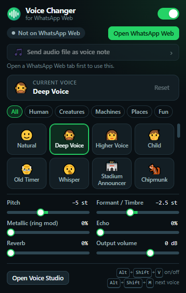
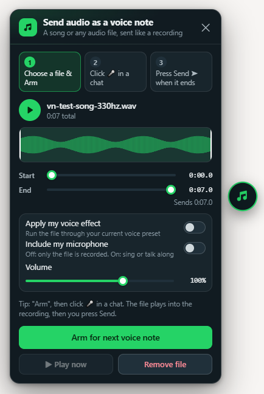
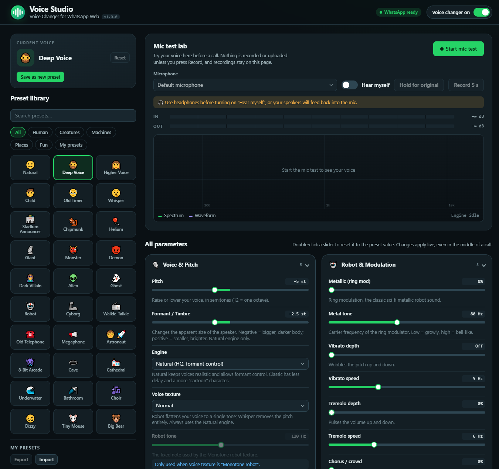

# Voice Changer for WhatsApp Web

A Chrome extension that changes your voice live on WhatsApp Web calls, and in the voice notes you record there. Pick one of the 30 preset voices or make your own with the sliders: pitch, formant, robot, echo, reverb, EQ, distortion and a few more. All the audio processing happens in your browser.

It only works on web.whatsapp.com in Chrome or Edge, not in the WhatsApp desktop or phone apps. Not affiliated with WhatsApp or Meta.

<p>
  
  
</p>

## Download

**[Download whatsapp-voice-changer.zip](https://github.com/thimiraperera/whatsapp-voice-changer/releases/latest/download/whatsapp-voice-changer.zip)** (always the latest version)

All versions are on the [Releases](https://github.com/thimiraperera/whatsapp-voice-changer/releases) page.

## Installing

It's not on the Chrome Web Store, so you load it as an unpacked extension. Takes about a minute:

1. Unzip the file into a folder you're going to keep. Chrome runs the extension from that folder, so don't delete it afterwards.
2. Open `chrome://extensions` (`edge://extensions` in Edge) and turn on Developer mode in the top right corner.
3. Click "Load unpacked" and select the folder with `manifest.json` in it.
4. Pin the extension from the puzzle piece menu so the icon stays in your toolbar.
5. Reload any WhatsApp Web tab that was already open. The extension hooks in when the page loads.

The Voice Studio opens by itself the first time. You can get back to it from the popup whenever you want.

## Using it

Click the toolbar icon for the popup. It has the on/off switch, all the presets, a few quick sliders (pitch, formant, metallic, echo, reverb, volume) and the button for sending an audio file as a voice note. The badge on the icon says ON when the extension is enabled and LIVE while it's changing your voice in that tab.

The Voice Studio is the full editor. Every setting is in there, plus a mic test where you can hear yourself, watch the levels and spectrum, hold a button to compare with your normal voice, or record a 5 second sample. You can save your own presets, rename them, and export or import them as JSON.

Keyboard shortcuts: `Alt+Shift+V` turns the voice changer on or off and `Alt+Shift+M` jumps to the next preset. You can change them at `chrome://extensions/shortcuts`.

Changes apply straight away, even in the middle of a call, so there's no need to hang up. I'd still try a voice in the Studio's mic test first, with headphones on, before calling someone with it.



### Sending a song or audio file as a voice note

This sends any audio file (mp3, m4a, wav, ogg, opus, flac, or the sound from an mp4/webm) as a normal voice message. The other person gets the usual green waveform bubble, not a file attachment.

1. On WhatsApp Web click the round 🎵 button on the right edge (or "Send audio file as voice note" in the popup) and choose or drop a file. You can trim it, preview it, run it through your voice effect, or turn on your microphone to talk or sing along. Then click "Arm for next voice note".
2. Open a chat and click WhatsApp's microphone button. The file plays into the recording and the panel shows the progress.
3. When it's done, press Send.

WhatsApp records voice notes from the microphone stream the extension already gives it, so the file simply plays into that stream instead of your mic. Nothing inside WhatsApp gets modified and nothing is clicked for you.

A few things to know:
- Voice notes are mono and heavily compressed. Music will sound like a voice message, not like the original file.
- An armed file waits up to 3 minutes for you to start recording. If you already started, click "Play now".
- With the microphone option off, your mic stays muted until you send, so the note only has the file in it.
- You can hide the 🎵 button in the Voice Studio (Call settings) and still open the panel from the popup.

### Presets

- Human: Natural, Deep Voice, Higher Voice, Child, Old Timer, Whisper, Stadium Announcer
- Creatures: Chipmunk, Helium, Giant, Monster, Demon, Dark Villain, Alien, Ghost
- Machines: Robot, Cyborg, Walkie-Talkie, Old Telephone, Megaphone, Astronaut, 8-Bit Arcade
- Places: Cave, Cathedral, Underwater, Bathroom
- Fun: Choir, Dizzy, Tiny Mouse, Big Bear

### Settings

- Voice and pitch: pitch (up to 24 semitones either way), formant (makes the voice sound bigger or smaller without changing the pitch), engine (Natural, or Classic for a more cartoony sound), voice texture (normal, monotone robot or whisper) and the robot's tone
- Robot and modulation: metallic ring mod, vibrato, tremolo, chorus
- Echo and space: echo amount, delay and repeats, reverb amount and room size
- Tone and EQ: low cut, high cut, bass, mid, treble
- Distortion and lo-fi: distortion, bit crush, sample crush, radio static (only while you talk)
- Clean-up and output: noise gate, compressor, effect mix (original vs changed voice) and output volume

Double-click a slider's label, or press Delete while it's focused, to put it back to the preset's value.

## How it works

When WhatsApp Web asks for the microphone, the extension takes the real mic track, runs it through its own effects and hands WhatsApp the processed track instead. That track behaves like the real one, so mute, hang up and the device settings all keep working. If anything goes wrong while setting it up, WhatsApp just gets your normal microphone and the call carries on.

The pitch and formant shifting runs on the audio thread in an AudioWorklet (a phase vocoder with a cepstral envelope, or a simpler granular shifter for the Classic engine). The rest of the effects are a regular Web Audio graph. Latency is about 21 ms with the Natural engine and about 25 ms with Classic, plus a few ms for the effects, which you won't notice on a call.

More detail, including how the pieces talk to each other, is in [docs/how-it-works.md](docs/how-it-works.md).

## Privacy

There are no network requests, no analytics and no accounts. Your audio only leaves the computer through WhatsApp's own call. The only permissions are `storage` for your settings and access to web.whatsapp.com. The mic test only records when you press Record, and that recording stays on the page until you download it or close it.

## Limitations

- Browser only, Chrome 111+ or Edge. The WhatsApp desktop and phone apps can't load extensions. For those you'd need a virtual audio cable and a system wide voice changer.
- The other person hears the changed voice. You hear yourself normally unless you turn on "Hear myself during calls", and then you need headphones or they'll get an echo.
- It also changes voice notes recorded on WhatsApp Web, since they use the same microphone.
- Very big downward shifts (more than about 10 semitones) on a voice that's already deep can sound a bit phasey. Try a little negative formant instead of more pitch.

## Troubleshooting

- Voice doesn't change: reload the WhatsApp tab after installing or updating the extension, and check the switch in the popup is on.
- The popup says to reload the WhatsApp tab: the tab was open before the extension loaded, so reload it.
- The other person hears an echo: turn off "Hear myself during calls" or use headphones.
- The other person hears nothing: turn the extension off with `Alt+Shift+V`. If the audio comes back, please open an issue. It's supposed to fall back to your normal mic when something fails.
- Robotic or choppy sound on a slow PC: switch the engine to Classic and lower the reverb room size.
- The audio file didn't play into the voice note: arm it first and then click the microphone. If you were already recording, use "Play now". If the 🎵 button is missing, reload the WhatsApp tab.
- "Could not read this audio file": the browser can't decode that format. Convert it to mp3 or m4a.

## Development

There's no build step and no dependencies. Edit the files, then click the reload arrow on the extension's card in `chrome://extensions`.

```bash
node tests/dsp.test.js
```

That runs the DSP tests in Node: pitch accuracy, formant movement, robot and whisper, gate, crushers, NaN safety, click-free switching and a real time performance check.

`tests/engine-harness.html` renders every preset through the full Web Audio graph in an OfflineAudioContext, and `tests/e2e/` loads the extension into a real Chrome, opens WhatsApp Web with a synthetic 140 Hz voice as the microphone and measures the pitch WhatsApp actually receives while presets are switched. See [tests/e2e/README.md](tests/e2e/README.md) for how to run those.
